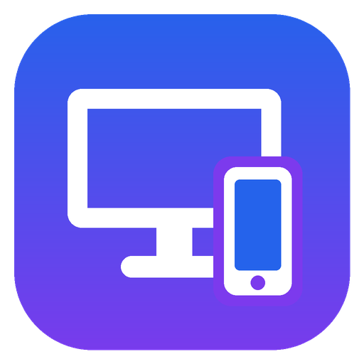

<p align="center"></p>

# Remote Desktop

Керування комп'ютером з Windows з Android-телефона або з ноутбука (через браузер) у локальній мережі (Wi-Fi).
На телефоні видно екран ПК, ним можна керувати пальцем як тачпадом або прямим дотиком, друкувати текст (також кирилицею) та натискати будь-які клавіші й комбінації. На ноутбуці працюють звичайні мишка, тачпад і клавіатура.

| Частина | Що це | Технології |
|---|---|---|
| `server/` | Портативний `RemoteDesktop.exe` для Windows 10/11: один файл без встановлення, живе в треї | Go без зовнішніх залежностей, GDI + SendInput |
| `server/web/` | Сторінка для ноутбука, її віддає сам `RemoteDesktop.exe` | HTML + JavaScript, WebSocket |
| `android/` | Застосунок `RemoteDesktop.apk` (Android 8.0+) | Java, без сторонніх бібліотек |

## Як користуватися

1. Запустіть `RemoteDesktop.exe` на комп'ютері. Програма з'явиться у треї біля годинника (на Windows 11 — можливо, під стрілкою «^»).
   Клацніть значок — буде вікно з IP-адресою і **PIN-кодом**. Під час першого запуску Windows може запитати дозвіл брандмауера — дозвольте доступ у **приватних мережах**.
2. Встановіть `RemoteDesktop.apk` на телефон (дозвольте встановлення з невідомих джерел).
3. Підключіть телефон до тієї ж Wi-Fi мережі, відкрийте застосунок — комп'ютер з'явиться у списку. Введіть PIN-код.

Якщо ПК не знаходиться автоматично, введіть його IP-адресу вручну (її показує значок у треї).

Програма сама запускається разом з Windows. Вимкнути це можна в меню значка (права кнопка) — «Запускати разом з Windows». Там же: новий PIN-код, журнал і «Вийти».

### З ноутбука

На ноутбуці (Windows, macOS, Linux — будь-яка система) нічого встановлювати не треба: відкрийте в браузері адресу `http://<IP комп'ютера>:47800` (точна адреса є у вікні, яке показує значок у треї) і введіть PIN-код.
Мишка, тачпад і клавіатура ноутбука керують комп'ютером; розкладку перемикає комп'ютер (Alt+Shift або Win+Пробіл).
Якщо підвести мишку до верхнього краю, з'явиться панель: Win, Alt+Tab, Win+D, диспетчер задач, «Текст…» (надрукувати текст з ноутбука), якість зображення, повний екран, відключення.
Клавішу Win і Alt+Tab перехоплює сама система ноутбука, тому для них є кнопки на панелі.
Якщо підключення не проходить, запустіть `RemoteDesktop.exe` один раз **від імені адміністратора**: програма сама додасть правило брандмауера.

### Жести

**Режим «Тачпад»** (за замовчуванням)
- ведіть пальцем — курсор рухається;
- дотик — клік, подвійний дотик — подвійний клік;
- подвійний дотик і ведення — перетягування;
- довге натискання або дотик двома пальцями — права кнопка;
- два пальці вгору/вниз — прокрутка, розведення пальців — збільшення (також кнопка «🔍» під «⋯»).

Коли зображення збільшене, курсор тримається в центрі екрана телефона, а картинка рухається під ним; біля краю екрана ПК картинка зупиняється і далі рухається вже курсор.
Курсор малює сам телефон з частотою екрана (60 Гц і більше), не чекаючи кадрів з ПК.

**Режим «Дотик»** — курсор переходить туди, де ви торкнулися, ведення пальцем перетягує.

Дотик трьома пальцями відкриває клавіатуру. На панелі внизу є Esc, Tab, стрілки, Ctrl/Alt/Shift/Win (вони «залипають» до наступної клавіші), а під кнопкою «⋯» — F1–F12, гарячі клавіші, керування гучністю та музикою. У «⚙» налаштовуються якість зображення, роздільність, частота кадрів і швидкість курсора.

### Параметри сервера

Налаштування зберігаються поруч з exe у `remote-desktop.json`.

```
RemoteDesktop.exe -newpin          згенерувати новий PIN
RemoteDesktop.exe -pin 1234        задати свій PIN
RemoteDesktop.exe -port 47800      змінити порт (TCP; автопошук працює на UDP 47801)
RemoteDesktop.exe -name "Офіс"     ім'я, яке бачить телефон
RemoteDesktop.exe -noautostart     не запускати разом з Windows
```

Журнал роботи — `remote-desktop.log` поруч з налаштуваннями (меню значка → «Відкрити журнал»).

### Обмеження

- Екран входу в Windows і вікна UAC (захищений робочий стіл) не передаються: так Windows обмежує звичайні програми.
- Щоб керувати вікнами, запущеними від адміністратора, сам сервер теж треба запустити від адміністратора.
- Трафік у локальній мережі не шифрується. Доступ захищено PIN-кодом; після 5 невдалих спроб адреса блокується на хвилину. Не відкривайте порт в інтернет.
- Поки телефон або ноутбук підключено, комп'ютер не переходить у сон.

## Збірка

Готові файли збирає GitHub Actions (`.github/workflows/build.yml`) і публікує в [Releases](../../releases).

Вручну:

```bash
# сервер (з Linux/WSL/macOS або Windows з Go 1.22+)
cd server && ./build-windows.sh 1.0.0 ../dist/RemoteDesktop.exe

# застосунок (потрібен Android SDK; або відкрийте папку android/ в Android Studio)
cd android && ./gradlew assembleRelease
```

APK підписується ключем `android/app/signing/remote-desktop.jks` (пароль `remotedesktop`), щоб нові збірки встановлювалися поверх старих. Ключ лежить у публічному репозиторії, тож для поширення застосунку іншим людям підпишіть його власним ключем через змінні `RD_KEYSTORE`, `RD_KEYSTORE_PASSWORD`, `RD_KEY_ALIAS`, `RD_KEY_PASSWORD`.

## Протокол

TCP, порт 47800. Кожне повідомлення: 1 байт типу, 4 байти довжини (big-endian), дані.

- `J` — JSON-команда: `hello` (PIN), `cfg` (якість, роздільність, fps, монітор), `mm`/`mr` (рух миші), `mb`/`click`/`wh` (кнопки, прокрутка), `key`/`tap`/`combo`/`text` (клавіатура), `ping`.
- `F` — кадр від сервера: координати курсора (2 × float32) і JPEG.
- `C` — (версія 2) позиція курсора, до ~60 разів на секунду: x, y, ширина й висота монітора (int32, фізичні пікселі), номер останнього застосованого руху (`i` з `mm`/`mr`, uint32) і прапорець видимості. Телефон одразу малює власні рухи й звіряє їх із цими звітами.
- `S` — (версія 2) зображення курсора: hotspot (2 × uint16) і PNG з прозорістю.
- `A` — підтвердження кадру від телефона. Сервер тримає не більше двох непідтверджених кадрів, тож затримка не накопичується на повільному Wi-Fi. Якщо екран не змінюється, нові кадри не надсилаються.

Клієнти версії 2 (`"ver":2` у `hello`) отримують курсор окремо (`C`/`S`), у кадрах його немає; старі клієнти отримують курсор, намальований у кадрі.

Браузер підключається до того самого порту: `GET /` — сторінка, `GET /ws` — WebSocket, де кожне бінарне повідомлення — це байт типу і дані (без 4 байтів довжини).

Автопошук: телефон надсилає UDP broadcast `RDESK?` на порт 47801, сервер відповідає JSON з іменем і портом.
